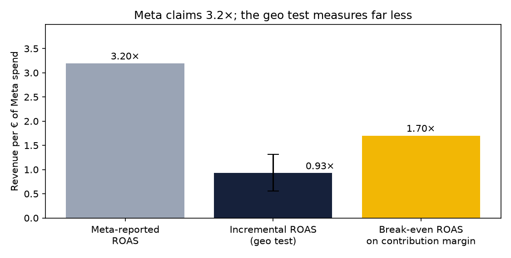
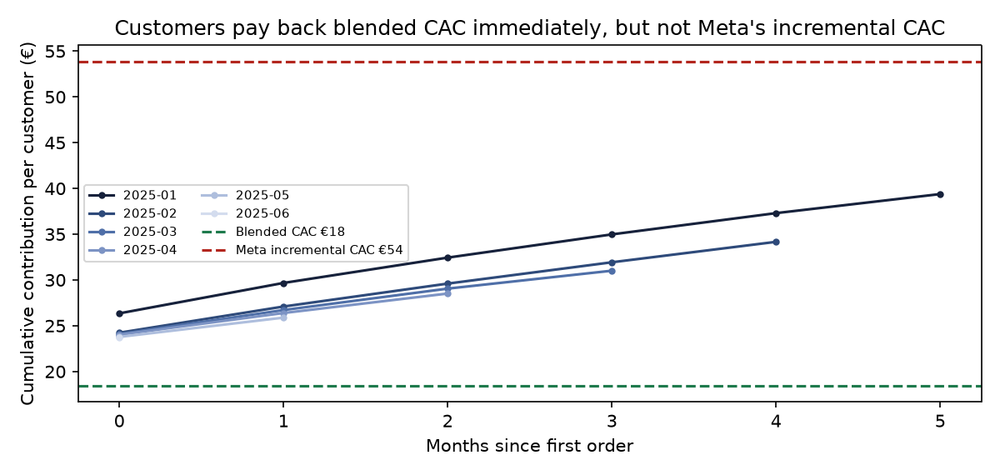
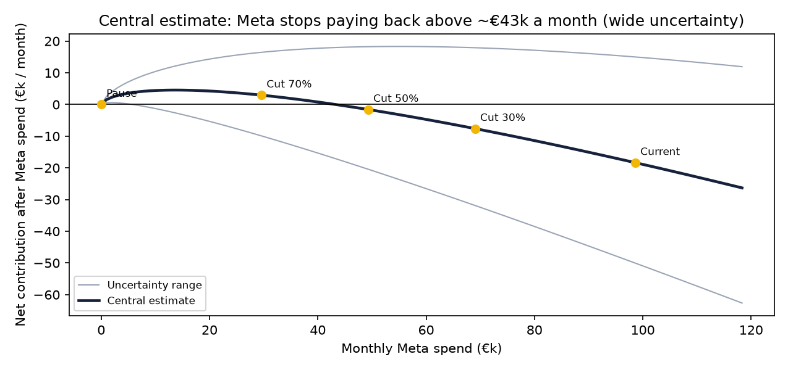
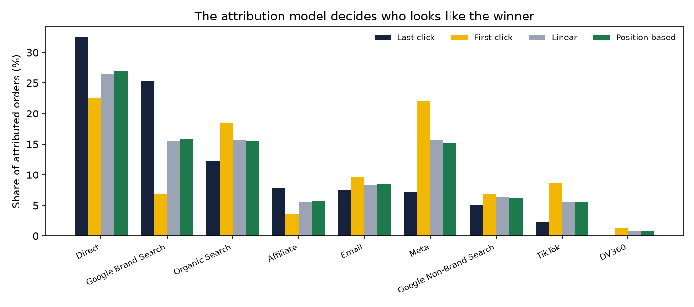

# Velora — Marketing Measurement & Growth Intelligence

> Where should the next euro of marketing spend go? A measurement project for a D2C skincare brand selling across
> Germany's 16 states: unified spend and channel KPIs, four attribution models, a pre-registered geo test on Meta,
> contribution-margin economics and budget scenarios.
> **Hands-on portfolio project on synthetic data** ([assumptions](docs/data_assumptions.md)), not production experience.

**Dashboard:** [Looker Studio](https://datastudio.google.com/reporting/6d09ed20-2302-48ca-90a6-a65d7c235c44) · **Decision memo:** [geo test readout](docs/geo_test_readout.md)

## The measurement problem
Velora (fictional, January–June 2025) took 102,193 orders worth €4.06M on €1.43M of marketing.
Three sources disagree by design: ad platforms claimed **121,813 conversions** (more than the real orders), GA4 saw only
**72%** of orders because of consent, and only the order system knew what was actually sold.

## Recommendation
**Cut Meta spend by about half, starting with retargeting, then re-test. Run a brand-search holdout next. Judge budgets on
incrementality and contribution margin, with MER as the weekly scoreboard, not on platform ROAS.**

## Key findings

**1. Meta drives real orders, but far fewer than it claims.** Pausing Meta in 8 of 16 states cut orders by
13.0% (95% CI 8.9% to 17.0%). Meta causes about 15% of orders while
claiming about 41%. Incremental ROAS is **0.93×** (range 0.56–1.31) against
**3.20×** reported by Meta, and below the **1.70×** break-even on contribution margin. [Full readout](docs/geo_test_readout.md)



**2. Blended CAC hides the problem.** Blended CAC is €18, which customers repay on their first order. But
each new customer Meta actually brings costs **€54**, more than the €39 contribution a customer generates in six months.



**3. Halving Meta spend improves profit.** On the central estimate, cutting Meta by 50% improves contribution after
marketing by about **€17k a month** (€12k–€22k across response-curve assumptions); Meta
stops paying back above roughly €43k a month. The uncertainty is wide, hence cut, then re-test.
During the test itself, weekly MER rose to 3.19 from 2.82: revenue fell less than spend.



**4. The attribution model decides who looks like the winner.** Meta receives 22% of credit under
first-click but 7% under last-click; brand search jumps from 7% to
25%. Google reports a **10.7×** ROAS for brand search, mostly from customers already
searching for Velora. Attribution shows channel roles; only tests show cause.



## Method
| Stage | What was done |
|---|---|
| Design first | [Metric spec](docs/metric_spec.md) with a source per metric, [attribution approach](docs/attribution_approach.md), [pre-registered geo test](docs/geo_test_design.md) with an MDE from placebo tests, [privacy note](docs/privacy_and_measurement.md) (GDPR, Consent Mode, DMA, SKAN) |
| Data model | dbt on DuckDB: 23 models, one channel-mapping macro, 65 tests including spend reconciliation and attribution credit checks |
| Geo test | Difference-in-differences with state and day fixed effects, clustered errors; parallel trends, ratio, leave-one-pair-out and placebo checks |
| Economics | Contribution margin per order; incremental ROAS, CAC and contribution; budget scenarios on a diminishing-returns curve with sensitivity |
| Communication | Memo and README generated from results; Looker Studio dashboard |

## Stack
DuckDB · dbt (dbt-duckdb, dbt_utils) · SQL · Python (pandas, statsmodels, matplotlib) · Looker Studio · Git/GitHub

## Reproduce
```bash
pip install -r requirements.txt
python scripts/generate_data.py && python scripts/load_to_duckdb.py
cd dbt && dbt deps && dbt build && cd ..        # 65 tests
python python/geo_test_analysis.py && python python/write_geo_readout.py
python python/budget_scenarios.py && python python/make_charts.py
python python/export_for_looker.py && python python/write_readme.py
```

## Limitations
- Synthetic data with stylised behaviour: it demonstrates method, not benchmarks.
- One four-week test measures short-term effects; brand-building effects of Meta are not captured.
- Budget scenarios extrapolate from one tested spend level using an assumed curve shape; re-testing is essential.
- Only Meta was tested; other channels' incremental value is unknown.

## Progress
- [x] Day 12 — business questions, metric spec, attribution approach, geo test design, privacy note, synthetic data, DuckDB load
- [x] Day 13 — dbt models: unified spend, channel KPIs, attribution models, cohorts
- [x] Day 14 — geo test analysis (difference-in-differences), ROAS vs iROAS, contribution economics
- [x] Day 15 — budget scenarios, Looker Studio dashboard, README findings, v1.0
