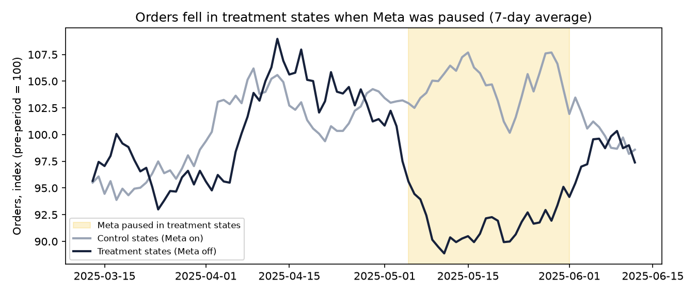
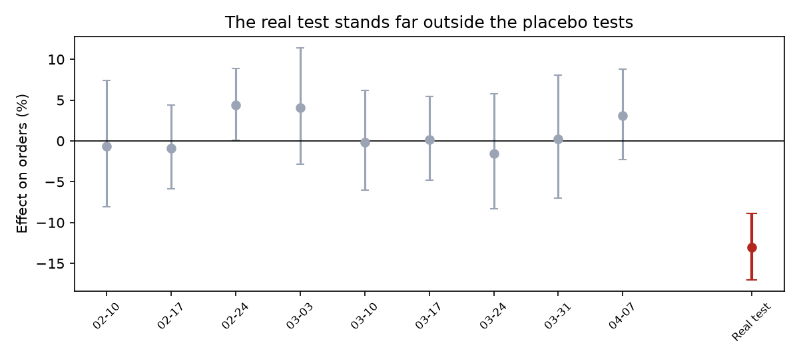
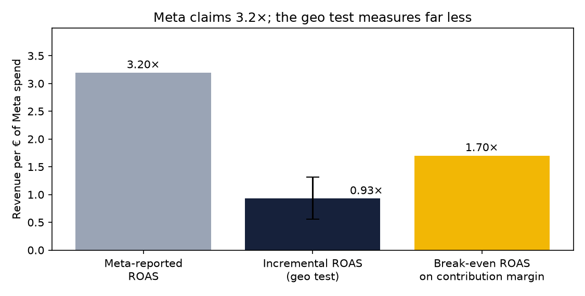

# Geo Test Readout: What Meta Really Causes

> Synthetic data. Analysis follows the pre-registered plan in [geo_test_design.md](geo_test_design.md).

## Recommendation
**Meta drives real orders, but far fewer than it reports, and at current spend it does not pay back. Velora should
reduce Meta spend, starting with retargeting, re-test at the lower level, and use incrementality, not platform ROAS,
to set budgets.** Brand search is the next test: it reports the highest ROAS of any channel.

## The result
| | Value |
|---|---|
| Effect of pausing Meta on orders | **-13.0%** (95% CI -17.0% to -8.9%; p < 0.001) |
| Share of orders Meta actually causes (treatment states) | **15%**, against ~41% of all orders that Meta claims |
| Incremental orders over 4 weeks (8 states) | 982 (range 639 to 1,341) |
| Meta spend avoided in treatment states | €40,372 |
| **Incremental ROAS** | **0.93×** (range 0.56× to 1.31×), against **3.20×** reported by Meta |
| Break-even ROAS on contribution margin | 1.70× (contribution margin is 59% of revenue) |
| Incremental contribution per € of Meta spend | €0.55 |
| **Incremental CAC** | **€54** per new customer Meta actually brings, against a blended CAC of €18 |
| 6-month LTV (contribution) of a new customer | €39, so even with repeat purchases, Meta-acquired customers do not pay back within 6 months |

## Can we trust it?
- **Parallel trends:** before the test, treatment and control states moved together (weekly divergence +0.0017, p = 0.77).
- **Same answer by a simpler method:** a plain before/after ratio comparison gives -13.0%.
- **No single pair drives it:** dropping each matched pair in turn gives -13.7% to -12.4%.
- **Placebo tests** on earlier weeks, when nothing changed, average +1.0%; the real test sits far outside them.
- **Consistent across outcomes:** revenue -12.6%, contribution margin -12.6%, new customers -14.6%.

## Every channel, through every lens
| Channel | Spend (6 months) | Platform-reported ROAS | GA4 last-click ROAS | Position-based ROAS | Incremental ROAS |
|---|---|---|---|---|---|
| Meta | €528,065 | 3.20× | 0.42× | 0.84× | **0.93×** (geo test) |
| TikTok | €290,192 | 2.05× | 0.24× | 0.55× | not yet tested |
| Google Non-Brand Search | €227,398 | 2.36× | 0.70× | 0.79× | not yet tested |
| DV360 | €192,583 | 2.09× | – | 0.12× | not yet tested |
| Google Brand Search | €151,599 | 10.67× | 5.25× | 3.04× | not yet tested |
| Affiliate | €34,415 | 10.00× | 7.20× | 4.42× | not yet tested |

GA4 columns cover only consented users (~72% of orders), so they understate every channel. The point of the table is the
spread: the same channel looks excellent or poor depending on the lens, and only a test measures cause.

## Why the numbers differ so much
1. **Meta counts conversions it touched, not ones it caused,** including people who saw an ad and would have bought anyway.
2. **Attribution windows overlap:** Meta, Google and affiliates can all claim the same order.
3. **Retargeting** reaches people already close to buying, so it collects credit with little incremental effect.

## Next steps
1. **Cut Meta retargeting first** and reduce prospecting gradually; with diminishing returns, the last euros spent are the least productive.
2. **Re-test Meta at the lower budget** to find the spend level where incremental ROAS reaches break-even.
3. **Run a brand-search holdout next:** it reports 10.7× ROAS, but mostly captures customers already searching for Velora.
4. **Make MER and order-system metrics the weekly scoreboard,** with platform ROAS as a diagnostic only.

## Limitations
Four weeks measures short-term effects only; longer-term brand effects of Meta are not captured. Some spillover between
states (people seeing ads in one state and ordering in another) would make the true effect slightly larger. With 16
states, the interval is wide: incremental ROAS could plausibly be anywhere from 0.56× to 1.31×,
but even the top of that range is below break-even.
